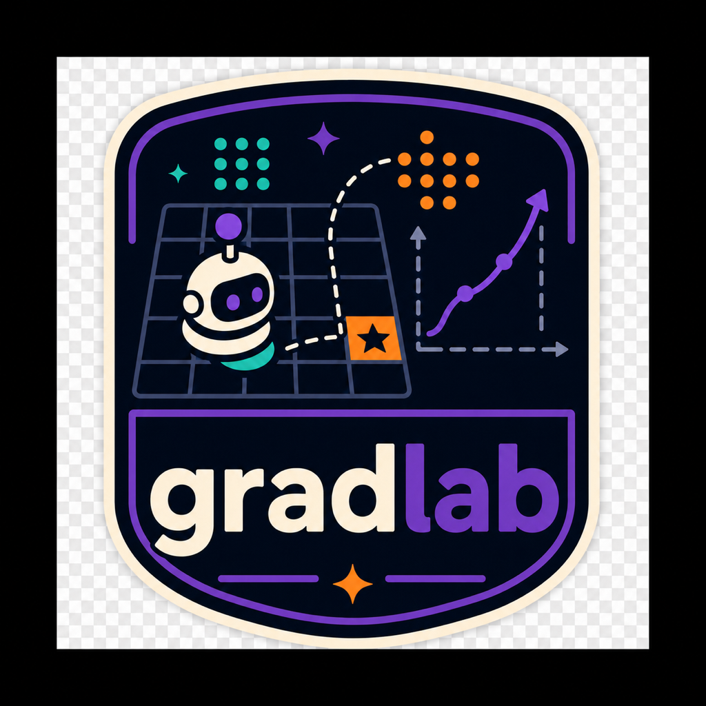

<p align="center">
  
  <br />
  <!-- repo-tagline:start -->
  <strong>🤖 RL workbench for training game agents 🎮</strong>
  <!-- repo-tagline:end -->
</p>

GradLab is a Python CLI for reinforcement learning researchers. Train game agents
from versioned goals and recipes, inspect their decisions in an interactive
player, and share checkpoints with the evidence needed to compare results.

## Quickstart

[Install uv](https://docs.astral.sh/uv/getting-started/installation/), then run
the bundled CPU example on macOS arm64 or Linux x86-64. It needs no checkout,
credentials, ROM, or tracking service. GradLab uses Python 3.14, which uv can
install automatically.

```bash
uvx gradlab@0.2.6 train gradlab__bandit/ppo
```

A completed run saves a playable policy under `~/.config/gradlab/runs/`.
Copy the playback command printed at the end to open the policy.

On Linux, the desktop player requires GTK 3 and WebKitGTK 4.1. Add `--no-open`
to use the printed local URL in your own browser. The installed package includes
the player assets.

## Explore GradLab

- [Recipes and local training](https://github.com/tsilva/gradlab/tree/main/experiments#readme) covers Atari, NES, ViZDoom, and Gymnasium examples, ROM setup, and tracking.
- [Player guide](https://github.com/tsilva/gradlab/blob/main/docs/player.md) covers browsing checkpoints, inspecting rewards, and exporting episodes.
- [Research catalog](https://github.com/tsilva/gradlab/blob/main/docs/hugging-face-catalog.md) links public policies, datasets, and gameplay videos.
- [Compute operations](https://github.com/tsilva/gradlab/blob/main/COMPUTE.md) covers queued training, evaluation, and the run architecture.
- [Source development](https://github.com/tsilva/gradlab/blob/main/docs/development.md) covers checkout setup, tests, and release validation.

Run `uvx gradlab --help` for the command list.

## License

[MIT License](https://github.com/tsilva/gradlab/blob/main/LICENSE) ·
[Third-party notices](https://github.com/tsilva/gradlab/blob/main/THIRD_PARTY_NOTICES.md)
