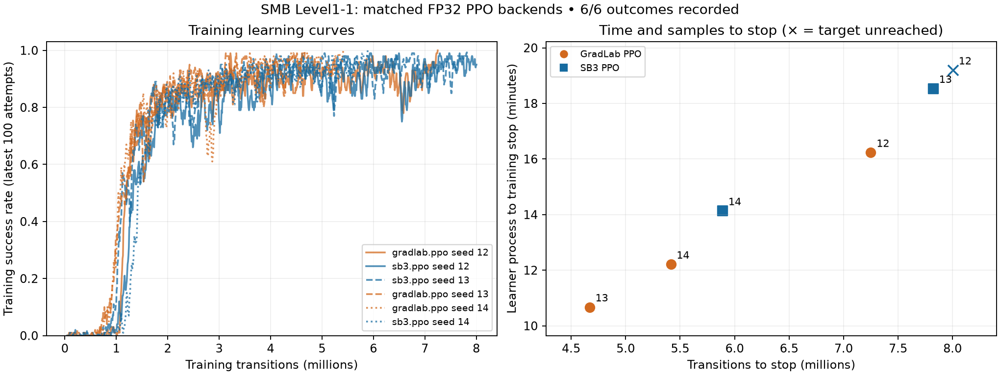

# SMB Level1-1 PPO backend comparison — 2026-10-27

Follow-up: [the completed 600-episode frozen-policy assessment](smb-level1-1-ppo-policy-quality-20261027.md) measured 97% clears for GradLab versus 95% for SB3 overall, with mixed results across the three training seeds. The training-only interpretation limits below describe the evidence available before that assessment.

Later decision: the [stopped execution-profile study](smb-level1-1-ppo-profile-ablation-20261027-stopped.md) and [stopped precision trial](smb-level1-1-ppo-precision-20261028-stopped.md) retain the subsequent evidence. The current Level1-1 recipe uses custom PPO in FP32, uncompiled and unfused. This report preserves the earlier `max-throughput` cohort and does not substitute for those later comparisons.

This experiment compares SB3 PPO 2.9.0 with GradLab’s tensor-native PPO backend in its default `max-throughput`, FP32 execution mode. It measures training outcomes, sample consumption and wall time on one GPU, with three paired seeds. It does not measure held-out checkpoint quality.

## Conclusion

GradLab PPO is the preferred training backend for this tested Level1-1 configuration: it reached the target in all three seeds, used fewer transitions in both pairs where both backends reached the target, and sustained higher observed loop throughput in every pair. This supports using it for this workload while retaining SB3 as a reference implementation.

- Seed 13: 40.3% fewer transitions and 42.4% less learner time to the same training stopping criterion.
- Seed 14: 8.1% fewer transitions and 13.6% less learner time to the same training stopping criterion.
- Seed 12: GradLab reached the target; SB3 did not reach it within 8,003,584 transitions. No SB3 time-to-success or percentage convergence improvement is estimated for this censored pair.

The wall-time improvement combines sample efficiency and execution speed. These observations do not prove an intrinsically better PPO algorithm or a more reliable frozen policy. Independent checkpoint evaluation and additional untouched seeds would be needed to answer those questions.

[Derived measurements (CSV)](smb-level1-1-ppo-backends-20261027.csv)

## Protocol

- Seeds: 12, 13 and 14. Sequential order: custom 12, SB3 12, SB3 13, custom 13, custom 14, SB3 14.
- Same immutable source and runtime, environment/provider, NatureCNN 512 network, actions, reward, observation preprocessing, start state, checkpoints and PPO hyperparameters within each pair.
- Same requested allocation: one NVIDIA RTX 4090, 12 CPU, 40 GB RAM and 50 GB disk. No concurrent training jobs in this comparison.
- Each Run has an 8,000,000-transition requested cap, rounded to 8,003,584 for full rollouts, and a 45-minute whole-task maximum. Early stop requires 100 consecutive genuine training clears.
- 16 environments × 512 steps per rollout; batch size 512; 10 epochs; gamma 0.9; GAE lambda 1.0; clip range 0.15; target KL 0.16; Adam epsilon 1e-8; value coefficient 1.0; advantage normalization disabled.
- Learning rate decreases from 0.00015 to 0.0001 over 4M transitions; entropy coefficient decreases from 0.01 to 0.0001 over 4M transitions. These absolute schedules were preserved when setting the smaller cap.
- Candidate-only execution: compiled policy calls, fused Adam and GPU minibatch permutations. Common mathematical settings are unchanged. Different random-number consumption and floating-point execution can produce different trajectories despite matching seeds.
- MLflow online delivery is enabled. Automatic checkpoint evaluation and Monitoring are disabled; no Acceptance or Promotion is claimed.

## Outcomes

`cap` means the training target was not reached within the shared budget. Its elapsed time is time spent at the cap, not an estimated time to success.

| Seed | Backend | Training stop | Transitions | Learner time, min | Final recent clear rate | Final mean return |
|---|---|---|---:|---:|---:|---:|
| 12 | `sb3.ppo` | cap; target unreached | 8,003,584 | 19.19 | 95% | 3048.64 |
| 12 | `gradlab.ppo` | 100 consecutive clears | 7,249,920 | 16.23 | 100% | 3123.65 |
| 13 | `sb3.ppo` | 100 consecutive clears | 7,823,360 | 18.53 | 100% | 3118.50 |
| 13 | `gradlab.ppo` | 100 consecutive clears | 4,669,440 | 10.67 | 100% | 3118.55 |
| 14 | `sb3.ppo` | 100 consecutive clears | 5,890,048 | 14.13 | 100% | 3119.54 |
| 14 | `gradlab.ppo` | 100 consecutive clears | 5,414,912 | 12.21 | 100% | 3125.97 |

Learner time runs from the learner process creation timestamp to its terminal training-result timestamp. It includes Python/model initialization, compilation and checkpoint creation, and excludes provisioning and post-learner delivery. The retained data also contains admission-to-terminal-receipt elapsed time. Process creation time was sampled once while each learner was alive; clock precision is approximately one second.

## Observed execution speed

Rates below divide total transitions by total measured loop time for complete timing windows within the 1M–4M training phase, rather than averaging per-report rates. SB3 timing frames are aligned to the preceding rollout before selecting the phase. This is an observed training workload comparison, not a fixed-trajectory kernel benchmark. PPO guard behavior and visited states can affect the measured phases.

| Seed | SB3 transitions/s | GradLab transitions/s | GradLab / SB3 |
|---|---:|---:|---:|
| 12 | 6,969 | 7,703 | 1.105× |
| 13 | 7,144 | 7,661 | 1.072× |
| 14 | 7,020 | 7,716 | 1.099× |

Geometric mean observed throughput ratio: **1.092×**.

Between-rollout timing includes optimization, callbacks and logging. It is not an isolated optimizer timer. GradLab emits aggregate timing windows of at least five seconds; SB3 reports individual iterations. The comparison uses matched transition ranges and each window’s actual transition count.

## Attribution of earlier training stops

The experiment observed fewer transitions to the shared training stopping criterion; it did not establish that execution-speed optimization intrinsically improves PPO sample efficiency. The mathematical hyperparameters were matched. The max-throughput profile changes minibatch permutations from NumPy to Torch on the GPU, uses a different flattening order for that shuffled buffer, enables compiled policy calls, and uses fused Adam. Those changes can alter random-number consumption and floating-point results, leading to different policy updates and subsequently different collected trajectories.

Two existing controlled CPU tests passed in a follow-up audit: tensor-buffer GAE/return parity and one PPO update with identical weights, data and NumPy minibatch order. These narrow tests do not establish full compiled-GPU training parity. The retained histories also show lower logged update KL in GradLab across the 1M–4M phase, but no actual optimizer-step count or minibatch trace was retained, so the reason and its causal contribution remain unestablished.

The 100-consecutive-clear stopping rule is sensitive to trajectory luck and small changes near a high success rate. First-hitting time is not a direct measure of samples needed to achieve a fixed independently evaluated policy-quality threshold. With only three training seeds, stochastic variation, numerical-path effects and stopping-time variability cannot be separated. Existing `sb3-parity`, `compiled-parity`, `compiled-fused-parity` and `max-throughput` profiles provide a possible ablation sequence; no such new training was performed in this audit.

## Interpretation limits

- Training target reached: GradLab **3/3**; SB3 **2/3**.
- Three paired seeds provide a small local experiment, not a general performance guarantee or statistical equivalence test. Unreached targets remain censored at the finite budget.
- The stopping metric covers the latest 100 genuine training attempts while the policy changes. It is not an independent fixed-policy evaluation. Final shaped return also cannot establish reliable completion.
- No final checkpoint was admitted for independent Acceptance evaluation. Better held-out policy quality, Acceptance and Promotion remain unestablished.
- The earlier historical SB3 Run `gradlab-f01275a06f52ba37a13c05efe033ca9d` reached the training target at 4,464,640 transitions on source `fe738b9688c0e7a48a4d46e1dd3ed6025adf0bb9`. It is retained as context and excluded from the paired comparison because source/runtime and instrumentation differ.

## Reading the comparison in MLflow

Open the six-Run `train/success/min` comparison in Brave. Select **Step** to compare sample consumption, then **Time (Relative)** to compare elapsed learning curves. The native relative axis starts at MLflow Run creation; use the receipt-based learner times above for the comparison that includes initialization and compilation but excludes provisioning.

For an individual Run, use its focused debugging dashboard. Read progress and return alongside `train/kl/mean`, `train/clip/fraction`, learning rate and entropy. A KL spike alone does not establish failed learning: PPO checks minibatches before updates, can stop the remaining epochs, and does not roll back previous updates. The logged KL and clip fraction also aggregate different windows.

For a speed change, compare `train/throughput/rate`, `train/provider/rate`, `train/rollout_overhead/seconds` and `train/between_rollouts/seconds`; between-rollout time includes optimization, callbacks and logging. Correlate hardware utilization, memory and temperature using wall timestamps because those samples use an operational sequence rather than training steps.

Check artifacts for the resolved recipe, provenance, checkpoint inventory and retained metric history. Check `ops/outbox/count` for pending delivery. Refresh the overview before reading its latest scalar values. Use terminal receipts and resource-release evidence to confirm completion.

The existing metric registry in `METRICS.md` defines each field and its limitations. No independent evaluation curves exist for these Runs because checkpoint evaluation was disabled.

## Provenance and verification

- Source: `2069964e7ce38de8f87392de084145e6af8f87d3`.
- Immutable runtime: `docker:ghcr.io/tsilva/gradlab/gradlab-train@sha256:e5b0b2978a608984c6d499d272de11081c6b8b07a7c9354a9bdcc865071cc1a3`.
- Every terminal receipt confirms retained metric journals, completed selected-service delivery, complete checkpoint inventory and quiescence. dstack reported terminal resource release before the next admission.
- All metric-journal segments were hash-verified with the maintained reader, including gap/conflict checks and terminal sequence agreement.
- Published final checkpoint bytes and recipe documents were checked against immutable receipts. Within each pair, the saved training configurations differ only in the backend ID and its execution fields.

| Seed | Backend | Public Run | Final checkpoint |
|---|---|---|---|
| 12 | `sb3.ppo` | [gradlab-cee45848f88ad68077142ce1ec618e3b](https://pub-fc35c0b186ce4aad8eea5e93d38c99db.r2.dev/runs/gradlab-cee45848f88ad68077142ce1ec618e3b/index.json) | [Download](https://pub-fc35c0b186ce4aad8eea5e93d38c99db.r2.dev/runs/gradlab-cee45848f88ad68077142ce1ec618e3b/checkpoints/8003584-2378332bc13debfc53034059dd8a0e0058d694b32da333ce230d3cc4d22ee29a/model.zip) |
| 12 | `gradlab.ppo` | [gradlab-ec4d2161868a2e4415e6bbac095f645b](https://pub-fc35c0b186ce4aad8eea5e93d38c99db.r2.dev/runs/gradlab-ec4d2161868a2e4415e6bbac095f645b/index.json) | [Download](https://pub-fc35c0b186ce4aad8eea5e93d38c99db.r2.dev/runs/gradlab-ec4d2161868a2e4415e6bbac095f645b/checkpoints/7249920-8bc9528f93265918d28d33074e677e98d0a38f9ecd91d448bdfc6de9b153ab94/model.zip) |
| 13 | `sb3.ppo` | [gradlab-a37c0921573cd00eb3bcc5462ed0b644](https://pub-fc35c0b186ce4aad8eea5e93d38c99db.r2.dev/runs/gradlab-a37c0921573cd00eb3bcc5462ed0b644/index.json) | [Download](https://pub-fc35c0b186ce4aad8eea5e93d38c99db.r2.dev/runs/gradlab-a37c0921573cd00eb3bcc5462ed0b644/checkpoints/7823360-f7587bfeca695e011e4a6a2b4bc144dd6ebf70f0933f0a8fe073a5c22e860256/model.zip) |
| 13 | `gradlab.ppo` | [gradlab-90db263ea7faf0fc0fa16e9a6bca45bf](https://pub-fc35c0b186ce4aad8eea5e93d38c99db.r2.dev/runs/gradlab-90db263ea7faf0fc0fa16e9a6bca45bf/index.json) | [Download](https://pub-fc35c0b186ce4aad8eea5e93d38c99db.r2.dev/runs/gradlab-90db263ea7faf0fc0fa16e9a6bca45bf/checkpoints/4669440-beffe4e7c35a624510a376cd6ca7adc59d372a76728b357028a6a0bb35ddc3a5/model.zip) |
| 14 | `sb3.ppo` | [gradlab-8ce2a26b50cd036e0d2824a67c805916](https://pub-fc35c0b186ce4aad8eea5e93d38c99db.r2.dev/runs/gradlab-8ce2a26b50cd036e0d2824a67c805916/index.json) | [Download](https://pub-fc35c0b186ce4aad8eea5e93d38c99db.r2.dev/runs/gradlab-8ce2a26b50cd036e0d2824a67c805916/checkpoints/5890048-60376335532624080ecd2b47e7445fb8be540c2cc5bf385739bddacf25ddaead/model.zip) |
| 14 | `gradlab.ppo` | [gradlab-704609e56cee40a96c79859d38e3cf20](https://pub-fc35c0b186ce4aad8eea5e93d38c99db.r2.dev/runs/gradlab-704609e56cee40a96c79859d38e3cf20/index.json) | [Download](https://pub-fc35c0b186ce4aad8eea5e93d38c99db.r2.dev/runs/gradlab-704609e56cee40a96c79859d38e3cf20/checkpoints/5414912-e1479d525c9cd2643c8e7c95d4f17d2870fbb26c79925f434ca92e7fdb32d038/model.zip) |

Use `gradlab play --run RUN_ID` for a selected Run. Playback does not create Acceptance evidence.
