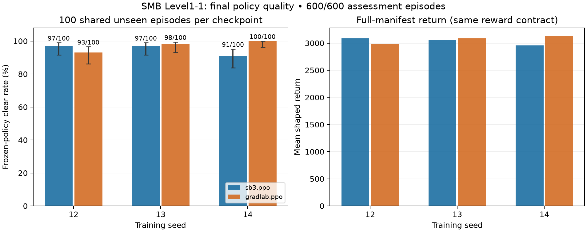

# SMB Level1-1 final-policy assessment — 2026-10-27

GradLab PPO achieved **291/300 clears (97%)** versus SB3’s **285/300 (95%)** on the six final checkpoints. The observed advantage is **2 percentage points**, with higher average shaped return (3066.56 versus 3031.66). Results vary by training seed: GradLab loses seed 12, is close on seed 13, and wins seed 14. This is encouraging evidence for these checkpoints, not proof that the backend generally learns better policies.

Together with the [matched training comparison](smb-level1-1-ppo-backends-20261027.md), this supports retaining GradLab PPO for this workload: it trained faster and did not show an aggregate final-policy quality penalty in this assessment. The quality advantage is less consistent than the training-time advantage.

## Results

All values use the complete 100-episode manifest, including failures. Clear rate is the primary behavioral measure; shaped return is secondary.

| Training seed | Backend | Clears | 95% Wilson interval | Mean shaped return | Mean steps, successful episodes only | Training transitions |
|---|---|---:|---:|---:|---:|---:|
| 12 | `sb3.ppo` | 97/100 | 91.5%–99.0% | 3085.72 | 526.33 | 8,003,584 |
| 12 | `gradlab.ppo` | 93/100 | 86.3%–96.6% | 2986.26 | 494.20 | 7,249,920 |
| 13 | `sb3.ppo` | 97/100 | 91.5%–99.0% | 3051.23 | 525.23 | 7,823,360 |
| 13 | `gradlab.ppo` | 98/100 | 93.0%–99.4% | 3087.93 | 524.91 | 4,669,440 |
| 14 | `sb3.ppo` | 91/100 | 83.8%–95.2% | 2958.02 | 501.99 | 5,890,048 |
| 14 | `gradlab.ppo` | 100/100 | 96.3%–100.0% | 3125.50 | 494.85 | 5,414,912 |



The aggregate 97% versus 95% is a descriptive average over three trained policies per backend. The 300 episodes per backend are not 300 independent training replications. Per-policy intervals describe finite episode sampling under this specific start-state/action-selection contract; they do not capture variation between training seeds or other environments.

## Paired comparisons

Episode IDs, environment seeds, lane quotas and start states match within every pair. The policies use their own stochastic action distributions, so matching seeds do not force matching trajectories.

| Training seed | Clear-rate difference, GradLab − SB3 | Mean paired return difference | Episodes only GradLab cleared | Episodes only SB3 cleared | Exact paired p-value |
|---|---:|---:|---:|---:|---:|
| 12 | -4 pp | -99.46 | 3 | 7 | 0.3438 |
| 13 | +1 pp | +36.71 | 3 | 2 | 1.0000 |
| 14 | +9 pp | +167.47 | 9 | 0 | 0.0039 |

The paired p-values are two-sided exact McNemar/binomial tests of discordant episode outcomes for each fixed-policy pair. They are unadjusted for three comparisons, rely on episode-sampling assumptions, and are not a test of backend-wide superiority. Seed 14 is the clearest observed fixed-policy difference; the other pairs are inconclusive at this episode count.

GradLab had nine failed episodes, all ending in life loss. SB3 had fourteen life-loss failures and one stall timeout. Short episodes can be failures, so overall mean episode length is not used as a success-speed ranking.

## Assessment protocol

- Exactly the final checkpoint from each of the six original Runs was selected before looking at assessment outcomes. No checkpoint replacement, new training, hyperparameter tuning or episode resampling was performed.
- Each checkpoint ran all 100 planned episodes on the same `vector-lane-v1` manifest: base evaluation seed 10000, 16 lanes, fixed quotas 7/7/7/7/6/6/6/6/6/6/6/6/6/6/6/6. The exact derived reset seeds and episode IDs are in the protocol JSON.
- Stochastic policy action selection, Level1-1 start, original provider, ROM identity, actions, reward shaping, observation preprocessing, frame skip 4, no sticky actions/noop reset, and 4500-transition episode/watchdog bounds are preserved from the identical saved evaluation contracts.
- The only approved assessment change is to disable first-failure stopping so that failures remain in complete 100-episode estimates. The immutable saved Acceptance contract remains unchanged.
- Assessments ran sequentially on the same host using CPU inference, one Torch intra-op/inter-op thread, an 8-CPU limit and a 40-GiB RAM limit. Each container had a 1200-second execution deadline; the campaign had a 7800-second maximum. No GPU was requested and unrelated services were preserved.
- One original RGB episode video, `lane-00-episode-000`, was recorded per checkpoint. It was chosen by manifest identity, not outcome. Video and result bytes were SHA-256 verified after delivery.
- This is a separate, explicitly requested non-Acceptance policy-quality assessment. It does not write canonical Acceptance/Promotion receipts or alter the original training Runs. Its measurements are in this report and its evidence files; no new evaluation points were projected into the original MLflow Runs.
- The exact runtime was available on the existing host. Modal had no exact-runtime readiness artifact and its workspace did not support native environment budgets, so no Modal workload was deployed or admitted.

## Interpretation and next decision

Our seed-14 final checkpoint is the strongest of the six by observed clear rate: **100/100**, mean return **3125.50**, and mean successful-episode length **494.85** transitions. Its 95% Wilson interval is approximately **96.3%–100%**; 100 observed successes do not establish zero failure probability. It is an assessment candidate, not a promoted or released Policy.

The same checkpoint reached the training stop at 5,414,912 transitions in 12.21 learner minutes, versus SB3 seed 14 at 5,890,048 transitions in 14.13 minutes. Thus that seed shows both faster training and higher observed final-policy quality. Seed 12 shows the tradeoff: our backend reached the training stop sooner but its final policy cleared fewer unseen episodes.

The final checkpoints were trained for different transition counts because of the shared early-stopping rule. This measures the policies produced by that training workflow, not equal-budget optimal policy quality. More untouched training seeds and a new untouched evaluation manifest would be needed for a broader superiority claim. Selecting seed 14 after this comparison also makes these assessment episodes selection data for subsequent decisions; a later independent test must remain separate.

## Provenance and evidence

- Original source: `2069964e7ce38de8f87392de084145e6af8f87d3`.
- Exact runtime: `docker:ghcr.io/tsilva/gradlab/gradlab-train@sha256:e5b0b2978a608984c6d499d272de11081c6b8b07a7c9354a9bdcc865071cc1a3`.
- Frozen plan SHA-256: `4727eb3970882f49ffe677afa652d5903c13726d85cc89654909e6956beeba6d`.
- Assessment runner SHA-256: `2e9a7468512105d84026ddd6d6295c18596618956eb65a7e6d95b3298e091726`.
- The existing durable GradLab local queue owns the six-checkpoint assessment job. The queue retained its initial pre-dispatch inspection failure and administrative retry; no scientific episode was run before that repair. Each named container was admitted once, with no scientific retries.
- Every model, model document and recipe was downloaded using the maintained immutable-public-manifest loader and verified against its declared hash. Every result contained exactly the complete frozen manifest, and aggregates were recomputed independently from retained episode rows. Every container exited with code zero and resource release was corroborated.
- [Summary CSV](smb-level1-1-ppo-policy-quality-20261027.csv), [all 600 episode rows](smb-level1-1-ppo-policy-quality-20261027-episodes.csv), and [frozen protocol](smb-level1-1-ppo-policy-quality-20261027-protocol.json).
- [Assessment runner](smb-level1-1-ppo-policy-quality-20261027-runner.py). To reproduce, mount the protocol JSON as `/assessment/plan.json`, the runner as `/assessment/evaluate.py`, a writable `/output`, and the verified ROM cache read-only as `/rom-cache` inside the pinned image. Run `python /assessment/evaluate.py LABEL` once for each frozen selection.

| Training seed | Backend | Original Run | Final checkpoint | Assessment video |
|---|---|---|---|---|
| 12 | `sb3.ppo` | [gradlab-cee45848f88ad68077142ce1ec618e3b](https://pub-fc35c0b186ce4aad8eea5e93d38c99db.r2.dev/runs/gradlab-cee45848f88ad68077142ce1ec618e3b/index.json) | [Download](https://pub-fc35c0b186ce4aad8eea5e93d38c99db.r2.dev/runs/gradlab-cee45848f88ad68077142ce1ec618e3b/checkpoints/8003584-2378332bc13debfc53034059dd8a0e0058d694b32da333ce230d3cc4d22ee29a/model.zip) | [Episode 1](smb-level1-1-ppo-policy-quality-20261027-videos/sb3.ppo-seed12.mp4) |
| 12 | `gradlab.ppo` | [gradlab-ec4d2161868a2e4415e6bbac095f645b](https://pub-fc35c0b186ce4aad8eea5e93d38c99db.r2.dev/runs/gradlab-ec4d2161868a2e4415e6bbac095f645b/index.json) | [Download](https://pub-fc35c0b186ce4aad8eea5e93d38c99db.r2.dev/runs/gradlab-ec4d2161868a2e4415e6bbac095f645b/checkpoints/7249920-8bc9528f93265918d28d33074e677e98d0a38f9ecd91d448bdfc6de9b153ab94/model.zip) | [Episode 1](smb-level1-1-ppo-policy-quality-20261027-videos/gradlab.ppo-seed12.mp4) |
| 13 | `sb3.ppo` | [gradlab-a37c0921573cd00eb3bcc5462ed0b644](https://pub-fc35c0b186ce4aad8eea5e93d38c99db.r2.dev/runs/gradlab-a37c0921573cd00eb3bcc5462ed0b644/index.json) | [Download](https://pub-fc35c0b186ce4aad8eea5e93d38c99db.r2.dev/runs/gradlab-a37c0921573cd00eb3bcc5462ed0b644/checkpoints/7823360-f7587bfeca695e011e4a6a2b4bc144dd6ebf70f0933f0a8fe073a5c22e860256/model.zip) | [Episode 1](smb-level1-1-ppo-policy-quality-20261027-videos/sb3.ppo-seed13.mp4) |
| 13 | `gradlab.ppo` | [gradlab-90db263ea7faf0fc0fa16e9a6bca45bf](https://pub-fc35c0b186ce4aad8eea5e93d38c99db.r2.dev/runs/gradlab-90db263ea7faf0fc0fa16e9a6bca45bf/index.json) | [Download](https://pub-fc35c0b186ce4aad8eea5e93d38c99db.r2.dev/runs/gradlab-90db263ea7faf0fc0fa16e9a6bca45bf/checkpoints/4669440-beffe4e7c35a624510a376cd6ca7adc59d372a76728b357028a6a0bb35ddc3a5/model.zip) | [Episode 1](smb-level1-1-ppo-policy-quality-20261027-videos/gradlab.ppo-seed13.mp4) |
| 14 | `sb3.ppo` | [gradlab-8ce2a26b50cd036e0d2824a67c805916](https://pub-fc35c0b186ce4aad8eea5e93d38c99db.r2.dev/runs/gradlab-8ce2a26b50cd036e0d2824a67c805916/index.json) | [Download](https://pub-fc35c0b186ce4aad8eea5e93d38c99db.r2.dev/runs/gradlab-8ce2a26b50cd036e0d2824a67c805916/checkpoints/5890048-60376335532624080ecd2b47e7445fb8be540c2cc5bf385739bddacf25ddaead/model.zip) | [Episode 1](smb-level1-1-ppo-policy-quality-20261027-videos/sb3.ppo-seed14.mp4) |
| 14 | `gradlab.ppo` | [gradlab-704609e56cee40a96c79859d38e3cf20](https://pub-fc35c0b186ce4aad8eea5e93d38c99db.r2.dev/runs/gradlab-704609e56cee40a96c79859d38e3cf20/index.json) | [Download](https://pub-fc35c0b186ce4aad8eea5e93d38c99db.r2.dev/runs/gradlab-704609e56cee40a96c79859d38e3cf20/checkpoints/5414912-e1479d525c9cd2643c8e7c95d4f17d2870fbb26c79925f434ca92e7fdb32d038/model.zip) | [Episode 1](smb-level1-1-ppo-policy-quality-20261027-videos/gradlab.ppo-seed14.mp4) |

To play the strongest observed checkpoint:

```bash
gradlab play --run gradlab-704609e56cee40a96c79859d38e3cf20
```
