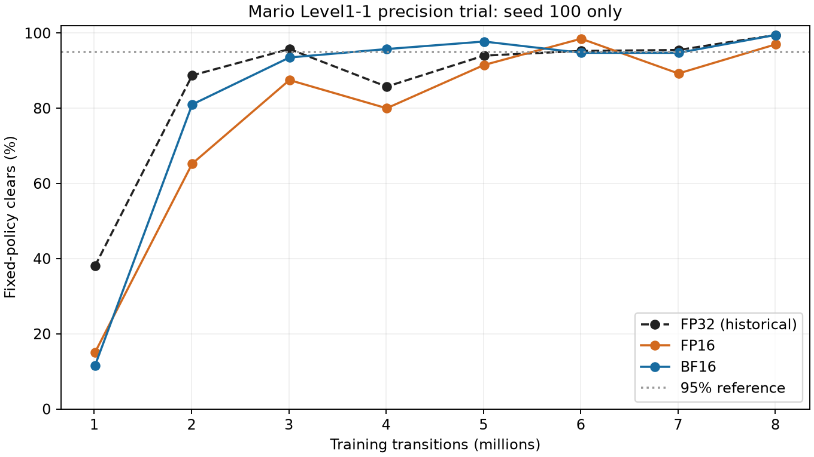

# Mario Level1-1 PPO precision trial — stopped by user

The user stopped the remaining experiments on 2026-10-28 and retained the Level1-1 default as custom `gradlab.ppo`, FP32, uncompiled and unfused (`sb3-parity`). The six-Run protocol was not completed. The queue is canceled, its worker exited, the active learner ended cooperatively, and actual owned training/assessment containers were verified absent. The monitor was deleted.

Two seed-100 learners completed 8,003,584 transitions each and all eight scheduled 400-episode assessments: **16 verified assessments / 6,400 episodes**. BF16 seed 200 was canceled at **6,324,224 transitions**, retaining seven published checkpoints but receiving no quality assessments. FP16 seed 200 and both seed-300 Runs were canceled before admission. No training or assessment computation was repeated.

## Completed seed-100 results

| Precision | Learner time including initialization | Weighted throughput, 1M–4M | First measured ≥95% checkpoint | Final clears | Normalized quality AUC |
|---|---:|---:|---:|---:|---:|
| FP32 — historical | 17.69 min | 7621.3/s | 3.006M | 99.50% | 0.8911 |
| FP16 | 20.88 min | 6448.6/s | 6.005M | 97.00% | 0.8114 |
| BF16 | 24.34 min | 5531.8/s | 4.006M | 99.50% | 0.8757 |

In this completed seed, FP16 took about 18% longer than historical FP32; BF16 took about 38% longer. BF16 matched FP32’s final 398/400 clears, while FP16 reached 388/400. Both mixed-precision quality curves crossed the 95% reference and later fell below it, so first attainment is not evidence of sustained performance.
BF16 seed 200’s retained journal also gives 5555.5 transitions/s over the complete 1M–4M timing window, versus historical FP32 seed 200’s 7635.8/s. Its canceled trajectory has no fixed-policy quality results.

These are observations from one fully assessed training seed, with a historical FP32 control and possible host-load differences. They do not establish a three-seed quality ranking or isolate precision as a causal mechanism. They support the user’s operational choice to retain FP32: mixed precision showed no runtime benefit in the measured runs.

## Interpretation and retained evidence

FP16 here is automatic mixed precision with gradient scaling, not wholesale conversion of all parameters and optimizer state to half precision. BF16 uses autocast without gradient scaling. Compilation and optimizer fusion were disabled for both. Assessment uses common CPU policy inference from immutable saved parameters.

Existing seed-100 timing diagnostics, normalized per million transitions, show native environment stepping near 26s for FP32 and 27s for FP16; rollout overhead near 51s and 59s; and time between rollouts near 54s and 70s. The latter includes updates, callbacks and logging. Casting/dispatch overhead, FP16 scaling checks and changed KL early-stopping work are plausible contributors; optimizer-step counts and kernel profiling were not recorded, so the exact mechanism remains unmeasured.

Checkpoint quality uses all 400 fixed episodes, base seed 20000, and the original assessment contract. AUC is normalized trapezoidal clear-rate area over the first-to-last common checkpoint grid. First threshold attainment is resolved only to checkpoint intervals. Episode intervals describe a fixed policy, not uncertainty across training seeds. These assessments confer no Acceptance, Promotion or Release.

Private scientific records retain each Run/Attempt, terminal and drain receipts, hash-verified metric journal, selected-service acknowledgements, checkpoint inventories, result/video hashes and release evidence. Service acknowledgements match journal high-water marks for all three admitted Runs, including the canceled Run. Published checkpoint indexes:
- [01-fp16-100: gradlab-fa6011f2a4078de9cd5a51702fa13926](https://pub-fc35c0b186ce4aad8eea5e93d38c99db.r2.dev/runs/gradlab-fa6011f2a4078de9cd5a51702fa13926/index.json) — succeeded, 8,003,584 transitions, 8 retained checkpoints.
- [02-bf16-100: gradlab-a147f8a41d25c6550d326ebc9661e5df](https://pub-fc35c0b186ce4aad8eea5e93d38c99db.r2.dev/runs/gradlab-a147f8a41d25c6550d326ebc9661e5df/index.json) — succeeded, 8,003,584 transitions, 8 retained checkpoints.
- [03-bf16-200: gradlab-7170aa747a3a35401b19a54e7cd82c90](https://pub-fc35c0b186ce4aad8eea5e93d38c99db.r2.dev/runs/gradlab-7170aa747a3a35401b19a54e7cd82c90/index.json) — canceled, 6,324,224 transitions, 7 retained checkpoints.

[Run-level data](smb-level1-1-ppo-precision-20261028-stopped-runs.csv) · [Verified checkpoint assessments](smb-level1-1-ppo-precision-20261028-stopped-checkpoints.csv) · [Original protocol](smb-level1-1-ppo-precision-20261028-plan.md)

Frozen source: `2069964e7ce38de8f87392de084145e6af8f87d3`. Runtime image digest: `sha256:e5b0b2978a608984c6d499d272de11081c6b8b07a7c9354a9bdcc865071cc1a3`. Original operational plan SHA256: `89cf211d0173f9abf10433e0f173c95c322b45c62748535dc493667582417a8d`; its bytes and original queue creation/deadline were preserved. Source changes and report publication are separate from these frozen scientific inputs.
